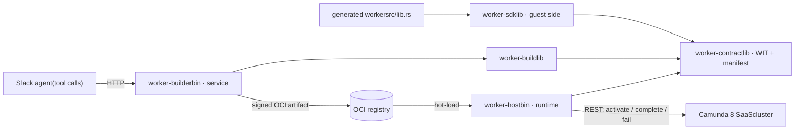

Contents

- [Overview](#overview)
- [Crate graph](#graph)
- [`worker-contract`](#contract)
- [`worker-sdk`](#sdk)
- [`worker-build`](#build)
- [`worker-builder`](#builder)
- [`worker-host`](#host)
- [Build pipeline and timing](#pipeline)
- [Security layers](#security)
- [Milestones](#milestones)
- [Open questions](#open)

Design draft · Rust workers as Wasm components

# Wasm Worker Crates

A Slack agent generates an "appliance" (BPMN, Rust job workers, and a manifest). Within one to two minutes it is built, tested, signed and ready to run on a shared worker host that talks to a Camunda 8 SaaS cluster. No new pod per worker.

Treat every worker as untrusted code: a model wrote it, and input from Slack can carry prompt injection. Security does not depend on anyone reading the Rust. It comes from the **manifest** (job types, outbound hosts, secret names, limits). A human approves the manifest, and both the builder and the host enforce it. Speed comes from a curated, pre-compiled dependency set, so each build compiles only the worker's own crate.

Library crates

`worker-contract`, `worker-sdk`, `worker-build`

Binaries

`worker-builder` (service), `worker-host` (runtime)

Guest target

`wasm32-wasip2`, component model

Target time

Request to "ready to deploy" in about 1–2 min (estimate)

## Crate graph

Arrows point from a crate to what it depends on. `worker-contract` is the single source of truth: the manifest the builder checks and the manifest the host enforces come from the same types.



| Crate | Kind | Runs where | Depends on | Main job |
| --- | --- | --- | --- | --- |
| `worker-contract` | lib | everywhere | serde, toml, semver; `wasmparser` behind a feature | WIT world, manifest types and validation, artifact metadata, shared API types |
| `worker-sdk` | lib | inside the Wasm guest | contract (WIT only), wit-bindgen, serde_json | The API the agent writes against |
| `worker-build` | lib | builder, CLI, CI | contract (+inspect), wasmtime (smoke test) | Render, check, compile, verify and test a worker |
| `worker-builder` | bin | isolated build service | worker-build, an HTTP server, an OCI client, signing | Run builds in a sandbox, sign, push, keep the source |
| `worker-host` | bin | one long-running pod (or a few) | contract (+inspect), wasmtime, wasmtime-wasi-http, an HTTP client | Load components, poll jobs, run them under limits |

## `worker-contract`

libshared by all

The contract between agent, builder, guest and host. Small and stable, with no heavy dependencies on the default feature set, so the guest SDK can depend on it too.

### Responsibilities

- Own the **WIT package** `camunda:worker`: the job record, the outcome variant, and the host interfaces (secrets, log, optional HTTP).
- Define two worlds: `worker` (no network) and `worker-http` (also imports `wasi:http/outgoing-handler`). The manifest decides which world is allowed.
- Own the **manifest** types and their validation: job types, limits, network allow-list, secret names, version.
- Own the **appliance bundle** type: BPMN/DMN/form files plus one or more workers, with a check that every service task job type in the BPMN has a worker.
- Own the shared API types: `BuildRequest`, `BuildReport`, `Diagnostic`, `ArtifactMetadata`. The agent tool, the builder and the host all use these, so they cannot drift.
- Behind the `inspect` feature: read a component's imports and exports with `wasmparser` and compare them to a validated manifest. Both the builder and the host call this.

### WIT sketch

```
package camunda:worker@0.1.0;

interface types {
  record job {
    key: u64,
    job-type: string,
    process-instance-key: u64,
    element-id: string,
    retries: u32,
    variables: string,                       // JSON
    custom-headers: list<tuple<string, string>>,
  }
  record failure   { message: string, retries: option<u32>, retry-backoff-ms: option<u64> }
  record bpmn-error { code: string, message: string, variables: option<string> }
  variant outcome  { complete(string), fail(failure), throw-error(bpmn-error) }
}

interface secrets { get: func(name: string) -> option<string>; }
interface log     { enum level { debug, info, warn, error } emit: func(level: level, msg: string); }

world worker {
  use types.{job, outcome};
  import secrets;
  import log;
  export handle: func(job: job) -> outcome;
}

world worker-http {
  include worker;
  import wasi:http/outgoing-handler@0.2.0;
}
```

### Manifest sketch

```
# worker.toml (the agent writes it, a human approves it)
[worker]
name      = "charge-card"
version   = "0.1.0"
job_types = ["charge-card"]

[limits]
memory_mb      = 64
timeout_ms     = 10_000      # must be below the job timeout
max_concurrent = 8

[network]
allow = ["api.stripe.com:443"]   # empty or missing = world "worker", no HTTP import

[secrets]
names = ["STRIPE_KEY"]
```

### Public API sketch

```
pub struct Manifest { /* serde mirror of worker.toml */ }
pub struct ValidManifest(Manifest);           // only made by validate()

pub fn validate(m: Manifest) -> Result<ValidManifest, Vec<ManifestError>>;
pub fn world_for(m: &ValidManifest) -> World;  // Worker | WorkerHttp

pub struct ArtifactMetadata {
    pub component_digest: Digest,   // sha256 of the .wasm
    pub source_digest: Digest,      // sha256 of the source tarball
    pub manifest: ValidManifest,
    pub contract_version: semver::Version,
    pub sdk_version: semver::Version,
    pub toolchain: String,          // rustc version
    pub lock_digest: Digest,        // the curated Cargo.lock
}

#[cfg(feature = "inspect")]
pub fn inspect(component: &[u8]) -> Result<ComponentInfo, InspectError>;
#[cfg(feature = "inspect")]
pub fn verify(info: &ComponentInfo, m: &ValidManifest) -> Result<(), Vec<Violation>>;
```

### Validation rules

- Names and job types match `^[a-z0-9][a-z0-9-]{0,62}$`. No wildcards in job types.
- Network entries are exact `host:port`, port 443 only by default. No IP literals, no wildcards, no private ranges.
- Limits have ceilings set by the platform (for example 256 MB memory, 60 s timeout).
- Secret names must exist in the target tenant's secret store. The builder checks the name; the host resolves the value.

### Tests

- Table tests for each validation rule, and round-trip tests for the TOML.
- `verify` tests against small fixture components: one with no HTTP, one that imports HTTP without a network allow-list (must fail), and one that imports an unknown interface (must fail).

## `worker-sdk`

libguest

The only API the agent sees. Small and typed, with no surprises, so a model writes it correctly on the first try. It compiles only to `wasm32-wasip2`.

### Responsibilities

- Wrap the `wit-bindgen` bindings in an ergonomic API: typed variables with serde, simple outcome constructors, a blocking HTTP client over `wasi:http`, `secrets::get`, and `log`.
- Export the worker with a `macro_rules!` macro, not a proc macro. The builder can then forbid all proc macros outside the pre-compiled set.
- Turn a panic into a `fail` outcome with a clear message instead of a trap, where possible. The host still treats a trap as a failure.
- Ship a short `AGENT_GUIDE.md` (the API in one page, with examples). It goes into the agent's tool description verbatim.

### What a generated worker looks like

```
use camunda_worker::prelude::*;

#[derive(Deserialize)]
struct Input { customer_id: String, amount_cents: u64 }

struct ChargeCard;

impl Worker for ChargeCard {
    fn handle(job: Job) -> Outcome {
        let input: Input = match job.variables() {
            Ok(v) => v,
            Err(e) => return Outcome::fail(format!("bad input: {e}")).no_retry(),
        };
        let key = secrets::get("STRIPE_KEY").expect("declared in manifest");

        let res = http::post("https://api.stripe.com/v1/charges")
            .bearer(&key)
            .form(&[("customer", input.customer_id.as_str()),
                    ("amount", &input.amount_cents.to_string()),
                    ("currency", "eur")])
            .send();

        match res {
            Ok(r) if r.status() == 200 => Outcome::complete(json!({ "charged": true })),
            Ok(r) if r.status() == 402 => Outcome::throw_error("PAYMENT_DECLINED", "card declined"),
            Ok(r) => Outcome::fail(format!("stripe returned {}", r.status())),
            Err(e) => Outcome::fail(e.to_string()).backoff_ms(5_000),
        }
    }
}

camunda_worker::export!(ChargeCard);
```

### Design rules

- Blocking calls only in v1. The component model's async story (WASI 0.3) can come later behind a new world, without breaking v1 workers.
- No feature flags the agent must pick. The HTTP module is always there; if the manifest has no network, the builder rejects the import and the agent gets a clear diagnostic.
- The SDK version is pinned per toolchain image. A new SDK version means a new pre-warmed image, never a cold build.

## `worker-build`

libno network

The rules of building. Pure logic plus an injected executor, so it is unit-testable and the same rules run in the builder service, a local CLI and CI. It never decides *where* code runs.

### Responsibilities

- **Render the project.** The agent supplies only `src/*.rs` and `worker.toml`. The crate writes `Cargo.toml` itself, with pinned dependencies from the allow-list, `[lints.rust] unsafe_code = "forbid"`, and the fast release profile. The agent cannot add crates, a `build.rs` or a proc macro.
- **Check the source** before rustc sees it: parse with `syn`, reject `extern crate`, `#[path]`, `include!` / `include_str!` / `include_bytes!`, `#![...]` crate attributes that loosen lints, and files or totals over the size limits.
- **Check fast.** `cargo check --message-format=json`, mapped into `Diagnostic` values (file, line, code, message, suggestion) that the agent can act on.
- **Build.** `cargo build --release --target wasm32-wasip2 --offline --locked` against a pre-warmed target directory.
- **Verify** the output with `worker_contract::inspect` + `verify`.
- **Smoke-test** it in Wasmtime with the manifest's limits, against sample jobs the agent provides, with a fake secrets store and a recording HTTP stub (no real network).
- **Produce** the artifact: component bytes, source tarball, `ArtifactMetadata`, and the input for signing.

### Public API sketch

```
pub struct Toolchain {
    pub rustc: String,            // e.g. "1.9x.0"
    pub vendor_dir: PathBuf,      // vendored crates, read-only
    pub warm_target: PathBuf,     // pre-built deps snapshot
    pub lockfile: PathBuf,        // the curated Cargo.lock
}

pub struct BuildInput {
    pub manifest: Manifest,
    pub sources: BTreeMap<RelPath, String>,   // only src/**.rs
    pub samples: Vec<SampleJob>,               // input + expected outcome kind
}

/// Side effects go through this trait: a local process for dev and tests,
/// a sandboxed container in the builder service.
pub trait Executor {
    fn run(&self, cmd: Cmd, limits: ExecLimits) -> Result<ExecOutput, ExecError>;
}

pub fn render(input: &BuildInput, tc: &Toolchain) -> Result<Project, Vec<Diagnostic>>;
pub fn check(p: &Project, tc: &Toolchain, ex: &dyn Executor) -> CheckReport;
pub fn build(p: &Project, tc: &Toolchain, ex: &dyn Executor) -> Result<Built, BuildFailure>;
pub fn smoke_test(b: &Built, samples: &[SampleJob]) -> Vec<TestResult>;
pub fn package(b: Built, tests: Vec<TestResult>) -> Artifact;

/// Runs all stages in order and stops at the first failing one.
pub fn run_pipeline(input: BuildInput, tc: &Toolchain, ex: &dyn Executor) -> BuildReport;
```

### Generated `Cargo.toml`

```
[package]
name = "worker"            # fixed; the real name lives in worker.toml
version = "0.0.0"
edition = "2024"
publish = false

[lib]
crate-type = ["cdylib"]

[dependencies]             # rendered from the allow-list, never from agent input
camunda-worker = "=0.1.0"
serde      = { version = "=1.0.x", features = ["derive"] }
serde_json = "=1.0.x"
chrono     = { version = "=0.4.x", default-features = false, features = ["serde"] }
regex      = "=1.x"

[lints.rust]
unsafe_code = "forbid"

[profile.release]          # tuned for build speed, not peak runtime speed
opt-level = 2
lto = false
codegen-units = 16
incremental = false
debug = false
strip = true
```

### How it stays fast

- One `Cargo.lock` per toolchain image. Its dependencies are compiled once into `warm_target`.
- Each build gets a copy-on-write copy of `warm_target` (overlayfs or reflink), so it compiles only the `worker` crate.
- The `check` stage shares the same warm metadata, so the agent's fix loop takes seconds.
- The allow-list is deliberately short. Each extra crate costs warm-up time and review, not build time.

### Tests

- Unit tests for render and the source checks with a fake `Executor`.
- Golden tests for the rendered `Cargo.toml`.
- One integration test (feature-gated, needs the toolchain) that builds and smoke-tests a fixture worker end to end, and asserts the time budget.
- Negative fixtures: `include_bytes!("/etc/passwd")`, `extern crate`, an HTTP import without a network allow-list, an endless loop (must hit the timeout).

## `worker-builder`

binruns untrusted rustc

A thin service around `worker-build`. Its value is the isolation and the warm pool, not logic.

### Responsibilities

- API: `POST /check` (fast, for the fix loop), `POST /builds` (full pipeline, streams stage events), `GET /builds/{id}`. Request and response bodies are the `worker-contract` types.
- Implement `Executor` as a sandbox: gVisor or nsjail, no network, a read-only toolchain and vendor directory, a tmpfs work directory, and CPU, memory, wall-time and output-size caps.
- Keep a pool of warm sandboxes per toolchain image, so a request never waits for a container start.
- Sign the component digest (KMS key or Sigstore) and push it with its metadata as an OCI artifact.
- Store the source tarball by digest for audit and for later rebuilds.
- Rate-limit per tenant and per caller.

The builder holds no Camunda credentials and no tenant secrets. A full compromise of one sandbox exposes only the source code under build.

## `worker-host`

binholds credentials

The long-running runtime. One pod (or a few for availability) runs many workers. A new worker is a hot-load, not a rollout.

### Responsibilities

- **Load.** Watch the registry or a control API for new appliance versions. Verify the signature, run `worker_contract::verify` again against the manifest, compile with Cranelift, and cache the native code by digest.
- **Link.** Use one `Linker` per world. A component that imports something outside its world fails to instantiate. That is the second enforcement point after the builder.
- **Isolate.** Use a fresh `Store` per job, with the pooling allocator, `StoreLimits` for memory, epoch interruption for the timeout, and no WASI filesystem, env or sockets.
- **Network.** Implement `wasi:http` outgoing requests through a custom send hook that checks the host and port against the manifest, resolves DNS itself, and blocks private and link-local addresses (protection against SSRF and DNS rebinding).
- **Secrets.** Resolve only the names in the manifest, from the tenant's secret store. Values never go to logs.
- **Camunda.** OAuth token cache, one long-poll activation loop per job type (REST `/v2/jobs/activation`), a concurrency cap per worker, then complete, fail or throw a BPMN error from the outcome. A trap or timeout becomes a fail with a clear message.
- **Operate.** Metrics and logs per worker and version, drain and roll back to the previous digest, a kill switch per worker.

### Shape

```
Registry watch ─▶ verify(sig) ─▶ verify(imports vs manifest) ─▶ compile + cache
                                                                    │
Camunda REST ◀── activate(job_type) ◀── poller per job type ◀──────┘
     ▲                                     │
     │                                     ▼
     └── complete / fail / throw ◀── run in fresh Store (mem cap, epoch timeout,
                                       allow-listed HTTP, scoped secrets)
```

The Camunda REST client could become its own crate later (`apps/c8cloud` already calls the REST API with `reqwest`). Keep it inside the host until a second user appears.

## Build pipeline and timing

The agent drives the first stages in a loop. Times are estimates for a single small worker with warm dependencies; measure them in milestone 2.

| Stage | Who | Crate | Time (est.) | On failure |
| --- | --- | --- | --- | --- |
| Generate BPMN, worker source, manifest, sample jobs | agent | – | 20–60 s | – |
| Validate manifest and bundle | builder | contract | \< 100 ms | diagnostics to agent |
| Render project, source checks | builder | build | \< 200 ms | diagnostics to agent |
| `cargo check` (fix loop, 1–3 rounds) | builder | build | 2–6 s per round | diagnostics to agent |
| Release build to `wasm32-wasip2` | builder | build | 5–15 s | diagnostics to agent |
| Verify imports, smoke test | builder | contract, build | \< 2 s | test report to agent |
| Sign, push, store source | builder | builder | \< 1 s | retry |
| Human approves the manifest in Slack | person | – | – | nothing deploys |
| Host verifies, compiles, starts polling | host | host | \< 1 s | keep previous version |

**Measured** (WP4, debug test build, this container, scaffold worker; the estimates above stay for the
full agent loop, which is not built yet):

| Stage | Measured | Note |
| --- | --- | --- |
| Render | 1 ms | |
| `check` (cargo check) | 18.3 s cold / 0.36 s warm | cold = empty shared target dir |
| `build` (release to `wasm32-wasip2`) | 14.6 s | |
| Verify imports | 0 ms | |
| Smoke test (`test`) | 2.6 s cold / 3.1 s warm | |
| Package | 3 ms | |
| **Total** | **35.5 s cold** | `check` + `build` + `test` dominate |

## Security layers

Each layer assumes the one before it can fail.

| Layer | Stops | Where |
| --- | --- | --- |
| Agent writes only `src/*.rs` and `worker.toml` | Extra crates, `build.rs`, proc macros | `worker-build` render |
| Source checks (`syn`), `unsafe_code = "forbid"` | Reading build-host files at compile time, unsafe tricks | `worker-build` |
| Sandboxed rustc, no network, caps | A compromise of the build host | `worker-builder` |
| Import check against the manifest | Hidden capabilities | `worker-contract` in builder *and* host |
| Signature check | Components the builder did not make | `worker-host` |
| Human approval of the manifest | A model or prompt injection that asks for too much | Slack flow |
| Wasm sandbox, memory and time limits, a Store per job | Escape, runaway loops, data leaks between jobs | `worker-host` |
| HTTP allow-list with host-side DNS | Exfiltration, SSRF | `worker-host` |
| Credentials only in the host, secrets by name | Leaked cluster credentials | `worker-host` |

## Milestones

- **1. Contract, SDK, host (local).** A worker written by hand and built with plain `cargo` runs in `worker-host` against a dev cluster. This proves the WIT, the limits and the job loop.
- **2. `worker-build` + CLI.** The same worker goes through render, check, build, verify and smoke test locally. Measure the real times against the table above.
- **3. `worker-builder` service.** Sandbox, warm pool, signing, registry. The host hot-loads from the registry.
- **4. Slack agent tool.** Generate the appliance, run the fix loop, post the manifest for approval, deploy the BPMN and the workers.

## Open questions

- **Who uses it:** the team only, or customers? This decides tenancy in the host (one host per tenant or shared), who may approve a deploy, and whether Wasm isolation is enough.
- **Where it lives:** `camunda-cloud-management-apps/crates/` already holds shared Rust (`ccma-server`). A separate repo may fit better if another team owns the runtime.
- **Who deploys the BPMN:** the host (one deploy for the whole appliance) or the agent through existing tooling.
- **Async:** stay on blocking WASI 0.2 for v1, or wait for WASI 0.3 async in Wasmtime.
- **The curated crate list:** which crates beyond serde, serde_json, chrono and regex earn their place (for example `base64`, `sha2`, `url`, `uuid`).